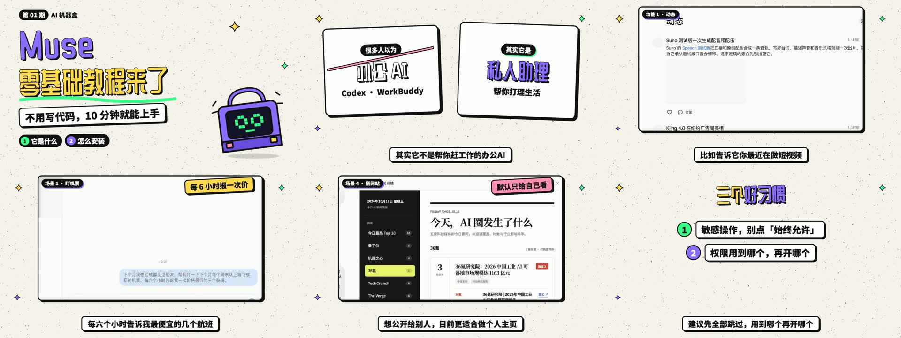

# dayun-sticker-tutorial-video

用《Muse 零基础教程》同款**手绘贴纸风**制作横版软件教程视频的 Agent Skill：米白噪点纸底、黄紫立体贴纸字、粗描边硬投影的录屏卡，录屏里推近拉远，底部白底黑边逐句字幕。



## 能做什么

- 以 [dy-video-kit](https://github.com/cxcxy/dy-video-kit) 的开场组件 C 起头，正片沿用同一套组件和配色。
- 真实操作被讲解的软件，只录目标窗口（ScreenCaptureKit，原生 2 倍分辨率），私人内容做模糊处理。
- 配音和逐字稿自动对齐成逐句字幕，镜头用关键帧对准重点。
- 附带静帧检查、渲染参数，以及在网络不稳定时把大文件切块上传 GitHub 的脚本。

## 目录

| 路径 | 内容 |
|---|---|
| `SKILL.md` | 触发条件和主流程 |
| `references/style-dna.md` | 画幅、配色、字体、组件分工、动效 |
| `references/production-workflow.md` | 从逐字稿到成片的每一步 |
| `references/scene-playbook.md` | 各类场景怎么搭、镜头怎么写 |
| `references/pitfalls.md` | 实际制作中踩过的坑 |
| `assets/template/parts.tsx` | 录屏卡、强调贴纸、板书组件、简笔图 |
| `assets/example/MuseEpisode.tsx` | 一整期的场景表范例 |
| `scripts/` | 窗口录屏、字幕对齐、缩略拼图、静帧检查、切块上传 |

## 安装

```bash
git clone https://github.com/cxcxy/dayun-sticker-tutorial-video.git
```
```bash
ln -s "$PWD/dayun-sticker-tutorial-video" ~/.claude/skills/dayun-sticker-tutorial-video
```

Codex 等其他 Agent 同理，链接到各自的 skills 目录。之后对 Agent 说“用 Muse 那期的风格做一期 XX 教程”即可触发。

## 依赖

- 视频工程：Node.js、[Remotion](https://www.remotion.dev/)、dy-video-kit 组件库（含字体，请自行确认字体授权）
- 媒体工具：ffmpeg、whisper.cpp（`whisper-cli` + `ggml-base.bin`）、Python 3
- 窗口录屏：macOS 12.3 及以上（ScreenCaptureKit）、Xcode 命令行工具（`swiftc`），首次运行需要授予“屏幕录制”权限
- 操作软件：支持 computer-use 的 Agent（如 Claude 桌面版）

## 说明

- 范例里的 Muse 界面截图只用于展示风格；Muse 是 Meta 的产品。
- 本仓库是从 DY-AI 技能库拆出的独立副本，两边会分别维护。
